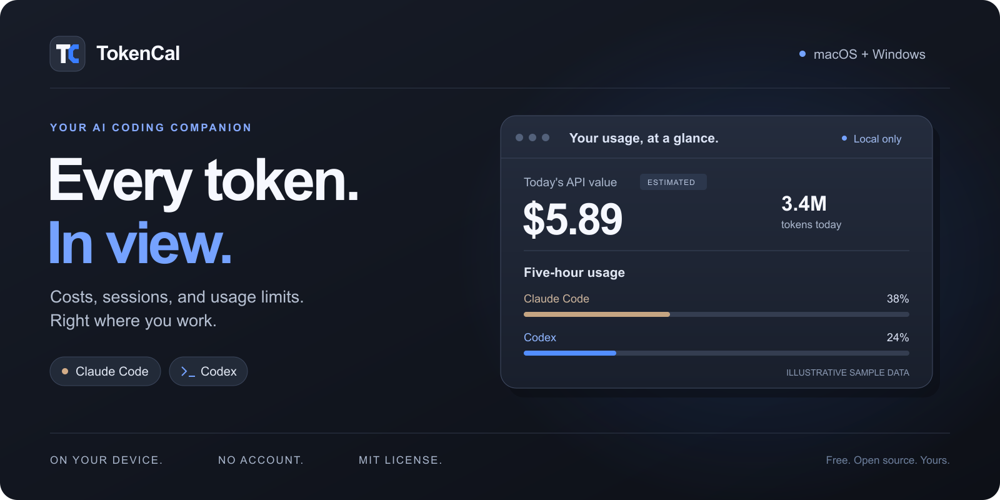
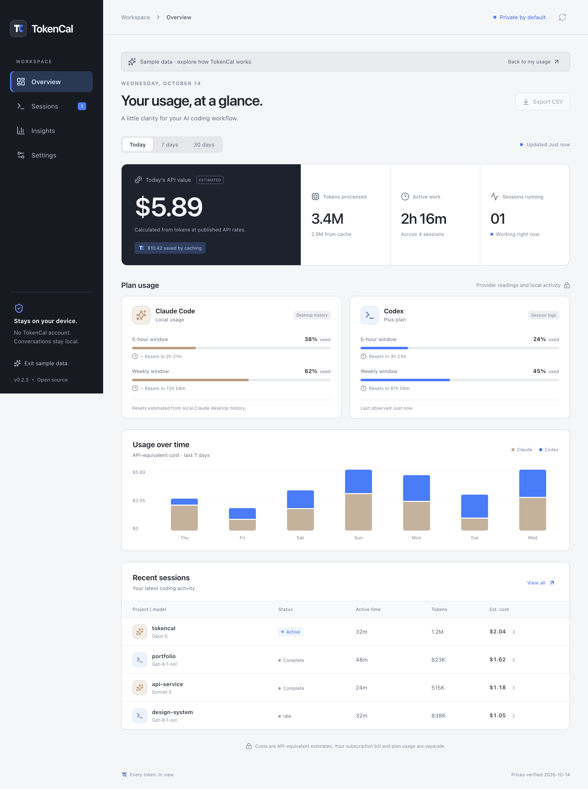

<div align="center">



# TokenCal

**A little clarity for your AI coding workflow.**

Token costs, session time, and usage limits for **Claude Code** and **Codex**,\
in your menu bar, system tray, or MacBook notch.

[](https://github.com/denzielnanda/TokenCal/actions/workflows/ci.yml)
[](LICENSE)
[](#get-tokencal)
[](#get-tokencal)

[**Get started**](#get-tokencal) · [Features](#made-for-the-way-you-code) · [How it works](#how-it-works) · [Contribute](CONTRIBUTING.md) · [Report a bug](https://github.com/denzielnanda/TokenCal/issues/new?template=bug.yml)

</div>

---

## Your usage, at a glance

See what your coding sessions are using without opening another dashboard in your browser. TokenCal reads the usage your tools already save on your computer, turns it into a clear daily overview, and keeps the essentials one click away.

**Free and open source. No TokenCal account or API key required. Your session data stays on your device.**



<p align="center"><sub>The app in sample mode. All values above are synthetic demonstration data.</sub></p>

## Made for the way you code

| | What you get |
| :--- | :--- |
| **A glance, wherever you work** | Today's estimated cost, tokens, active sessions, and plan usage in your menu bar or Windows tray. |
| **A home beside the camera** | A MacBook notch widget with expandable details. A top-edge panel on other Macs and Windows. |
| **Every session in context** | Project, model, input/output/cache tokens, active work time, session span, and estimated cost. |
| **Usage windows with context** | Recorded five-hour, weekly, and model-specific limits, reset countdowns, and clear labels when observations are stale. |
| **The bigger picture** | Daily charts, model and project breakdowns, local CSV export, price overrides, and optional usage notifications. |

> **An estimate, not an invoice.** Costs represent the API-equivalent value of recorded tokens. They do not represent your subscription charge or remaining plan allowance. Unknown prices and reset times stay unknown. [Read the accuracy notes →](docs/accuracy.md)

## Get TokenCal

**TokenCal is an early preview. Source is available now; downloadable installers have not been published yet.** Follow the [Releases page](https://github.com/denzielnanda/TokenCal/releases) for packaged builds. Current signing and platform validation are documented in [validation](docs/validation.md).

### Run from source

Install **Node.js 24 LTS**, then run:

```sh
git clone https://github.com/denzielnanda/TokenCal.git
cd TokenCal
npm ci
npm run dev
```

The dashboard and native tray start together. On macOS, use **macOS 14 or later** with Xcode Command Line Tools for the display helper. Windows builds do not require Xcode.

1. Start a Claude Code or Codex session. TokenCal discovers supported local logs automatically.
2. Click the menu bar or tray icon for a quick overview.
3. Enable **Show notch / top-edge widget** in Settings to keep usage beside your work.

Large histories may take a few seconds to scan. Move the dashboard by its title bar, header, or TokenCal logo. Closing the dashboard keeps the app in the menu bar or tray; right-click the icon to refresh, show the widget, or quit.

**Local tracking works without login setup.** Both Claude Code and Codex tokens, estimated costs, and session time are read automatically from their local logs. Codex saves plan-limit observations in those logs; Claude plan percentages come from the desktop history file, as in Vorssaint. If that history stops updating, only the plan readings become stale—session tracking continues.

An optional **live Claude plan usage** setting can read current allowances from Anthropic using an existing Claude Code login. It is **off by default**, requires confirmation, and may need macOS Keychain permission. It makes a read-only account API request, not a model request. No API key, TokenCal account, status line, hook, or agent-settings edits are needed for normal tracking.

<details>
<summary><strong>Installer guide — for future packaged releases</strong></summary>

| Your computer | Package |
| :--- | :--- |
| Apple Silicon Mac | `TokenCal-<version>-mac-arm64.dmg` |
| Intel Mac | `TokenCal-<version>-mac-x64.dmg` |
| Windows x64 or ARM64 | `TokenCal-<version>-windows-setup.exe` — selects the architecture automatically |

On macOS, drag TokenCal into Applications. On Windows, run the installer. Packaged apps need no terminal, Node.js, Xcode, or folder setup. Launch at login is optional.

Local Mac builds currently use ad-hoc signatures; Windows builds are unsigned. Signing and notarization remain part of release preparation. See [release instructions](docs/releasing.md).

</details>

## How it works

```text
Claude Code / Codex local logs
              ↓
  Read-only background parser
              ↓
  Usage metadata on your device
              ↓
   Dashboard · tray · notch
```

| Source | What TokenCal reads |
| :--- | :--- |
| Claude Code project logs | Per-response tokens, model, timestamps, project names, and turn boundaries |
| Codex session and archived-session logs | Response usage or legacy token totals, models, turn boundaries, and recorded account limits |
| Optional account connection, off by default | Current Claude subscription percentages and provider reset times via Anthropic |
| Claude desktop's `plan-usage-history.json` | Default Claude plan percentages and the history of usage drops |

In default local mode, TokenCal never reads a login or contacts a provider. Claude plan percentages depend on the desktop history file; they may be unavailable or old in some desktop versions. Codex limits update when a new observation is written to its logs. Cloud-only ChatGPT chats and remote sessions need local logs to appear here.

If you explicitly enable the optional live account mode, it uses the `Claude Code-credentials` Keychain item on macOS or `.credentials.json` in the selected Claude configuration directory on Windows/custom profiles. That login must support subscription usage access. The access token is sent only to Anthropic and never saved or exported.

<details>
<summary><strong>Custom folders, WSL, and source details</strong></summary>

- Claude Code defaults to `~/.claude/projects/**/*.jsonl`; older `~/.config/claude/projects` installations are detected.
- Codex defaults to `~/.codex/sessions/**/*.jsonl` and `archived_sessions`.
- `CLAUDE_CONFIG_DIR` and `CODEX_HOME` are respected. All source paths can be changed in Settings.
- Claude desktop history is searched in `~/Library/Application Support/Claude` on macOS and `%APPDATA%/Claude` on Windows.
- On Windows, running WSL distributions and their default user homes are detected automatically. TokenCal does not start stopped distributions. Choose custom WSL agent homes in source details.

Live Claude readings include provider reset timestamps. Desktop history contains percentages without those timestamps; its inferred reset times are marked `~`. Unknown reset times remain unknown. [Source and accounting details →](docs/accuracy.md)

</details>

## Private by design

The default app reads local files without **login setup, credential access, or background network requests**. It has no analytics or telemetry and never retains conversation content, adds hooks, or changes agent configuration.

Optional live Claude plan usage reads the existing Claude Code access token and contacts Anthropic only after you enable it and confirm. Tokens stay in main-process memory and are never cached, rendered, or exported. No browser cookies or unrelated credentials are read.

Cached metadata includes source paths, session IDs, project folder names, token counts, models, and timing. [Read the privacy guide →](docs/privacy.md)

## Build something useful with us

Bug reports, parser fixes, platform testing, and interface improvements are welcome. Start with the [contributing guide](CONTRIBUTING.md). Use synthetic or redacted examples when reporting an issue; keep real transcripts and credentials out of public posts.

```sh
npm run check          # regression tests + production build
npm run test:desktop   # desktop smoke test with synthetic logs
npm run dist:mac       # macOS DMG + ZIP, Apple Silicon and Intel
npm run dist:win       # Windows installer + ZIP, x64 and ARM64
```

Build installers on the matching operating system. Outputs go into `release/`. The GitHub workflows check macOS and Windows; a version tag starts packaging and creates a **draft** release for review.

| Explore | |
| :--- | :--- |
| [Architecture](docs/architecture.md) | App structure and module responsibilities |
| [Accuracy and sources](docs/accuracy.md) | Accounting rules, pricing, and reset inference |
| [Validation](docs/validation.md) | What has been tested and remaining platform checks |
| [Release guide](docs/releasing.md) | Packaging, signing, and publication |
| [Security policy](SECURITY.md) | How to report a vulnerability privately |

## Acknowledgements

Research was informed by [Vorssaint's public usage-tracking documentation and source](https://github.com/vorssaint/vorssaint-utils/tree/main/Sources/Vorssaint/Services/AgentUsage). TokenCal uses its own TypeScript implementation, interface, and brand assets.

---

<div align="center">

**Every token. In view.**

[MIT licensed](LICENSE) · Built for the open-source community · Not affiliated with Anthropic or OpenAI

</div>
